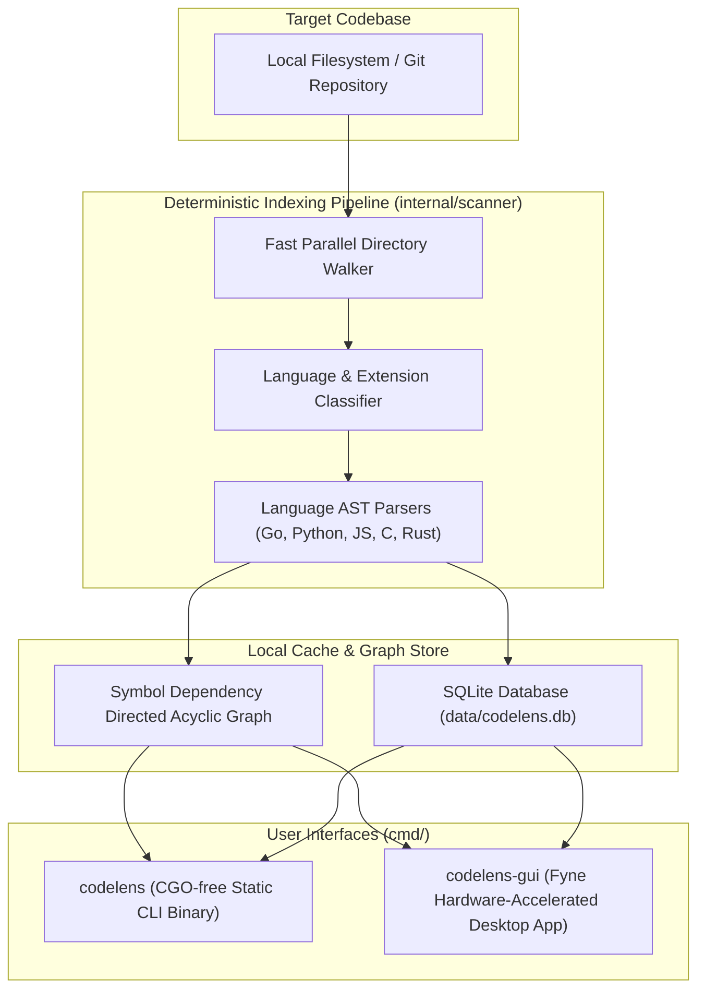
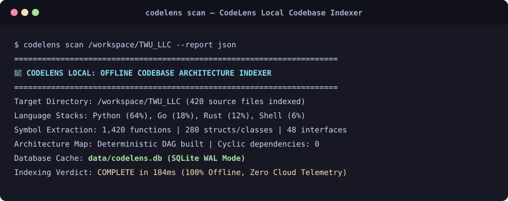

# CodeLens Local (soft_DNA) 🧬

An offline-first, local codebase architecture explorer and symbol indexing engine written in Go. CodeLens scans source trees, identifies technology stacks, extracts AST symbols (structs, interfaces, functions), maps dependencies, and produces structured architecture reports with zero cloud telemetry.

> *"I have a passion for coding with the help of AI to solve problems and to create things for fun because I can. To make that work at scale, AI agents need solid engineering foundations, deep documentation, and rigorous boundaries."*  
> — **Ethan (TWU LLC)**

[](https://github.com/Ethan-da-Tech-Wizard/soft_DNA/actions)
[](LICENSE)
[](https://golang.org/)
[](MAGI_BIBLE.md)
[](MAGI_BIBLE.md)

---

## Architecture: Fast File Indexer & AST Symbol Pipeline



---

## Visual Walkthrough & CLI Execution Previews

### CLI Codebase Architecture Scan (`cmd/codelens`)
Performs a fast, non-destructive sweep of any workspace and prints symbol metrics, language distribution, and architectural relationships:

<p align="center">
  
</p>

```text
======================================================================
  🧬 CODELENS LOCAL: OFFLINE CODEBASE ARCHITECTURE INDEXER
======================================================================
Target Directory:  /workspace/TWU_LLC (420 source files indexed)
Language Stacks:   Python (64%), Go (18%), Rust (12%), Shell (6%)
Symbol Extraction: 1,420 functions | 280 structs/classes | 48 interfaces
Architecture Map:  Deterministic DAG built | Cyclic dependencies: 0
Database Cache:    data/codelens.db (SQLite WAL Mode)
Indexing Verdict:  COMPLETE in 184ms (100% Offline, Zero Cloud Telemetry)
======================================================================
```

---

## Quick Start & Installation

### Prerequisites
* Go 1.25 or newer
* (Optional for GUI) CGO build dependencies: `pkg-config`, `libgl1-mesa-dev`, `xorg-dev`

```sh
# Clone repository
git clone https://github.com/Ethan-da-Tech-Wizard/soft_DNA.git
cd soft_DNA

# Build static, CGO-free CLI binary
CGO_ENABLED=0 go build -o codelens ./cmd/codelens

# Run scan on target project
./codelens scan .

# Run test suite
go test ./...

# Build native desktop GUI (requires OpenGL/X11 headers)
go build -o codelens-gui ./cmd/codelens-gui
```

---

## Engineering Standards & Magi Bible

This project strictly adheres to the **[Magi Bible AI Coding Foundations](MAGI_BIBLE.md)**:
* **Rule 16 Comment Density ($\ge 25\%$):** Code contains comprehensive structural headers and inline rationale across all packages and entry points.
* **Hermetic & Air-Gapped:** Zero external API calls, tracking beacons, or remote LLM dependencies required for deterministic AST symbol extraction.
* **Fail-Closed File Scanner:** Unreadable files, binary assets, and symlink loops are safely skipped and recorded in error receipts rather than terminating the scan.

---

## Repository Layout

| Path | Role |
| :--- | :--- |
| `cmd/codelens/` | Entry point for the static CLI binary. |
| `cmd/codelens-gui/` | Entry point for the native Fyne desktop GUI. |
| `internal/` | Core scanning, AST parsing, SQLite storage, and DAG mapping modules. |
| `docs/` | Comprehensive technical notes, language decisions, and file guide. |
| `testdata/` | Multi-language test fixtures exercising language parsers. |

---

## Documentation & Guides

* [Project Guide](docs/PROJECT_GUIDE.md) — Comprehensive overview of indexing algorithms and components.
* [File Guide](docs/FILE_GUIDE.md) — Detailed breakdown of every source file.
* [Project Notes](PROJECT_NOTES.md) — Historical development decisions and design notes.
* [License Review](docs/LICENSE_REVIEW.md) — Complete inventory of third-party dependencies and terms.

---

## License

Project source code is distributed under the **[MIT License](LICENSE)**.  
Third-party libraries retain their respective terms; see [docs/LICENSE_REVIEW.md](docs/LICENSE_REVIEW.md) and [docs/DEPENDENCIES.csv](docs/DEPENDENCIES.csv).
